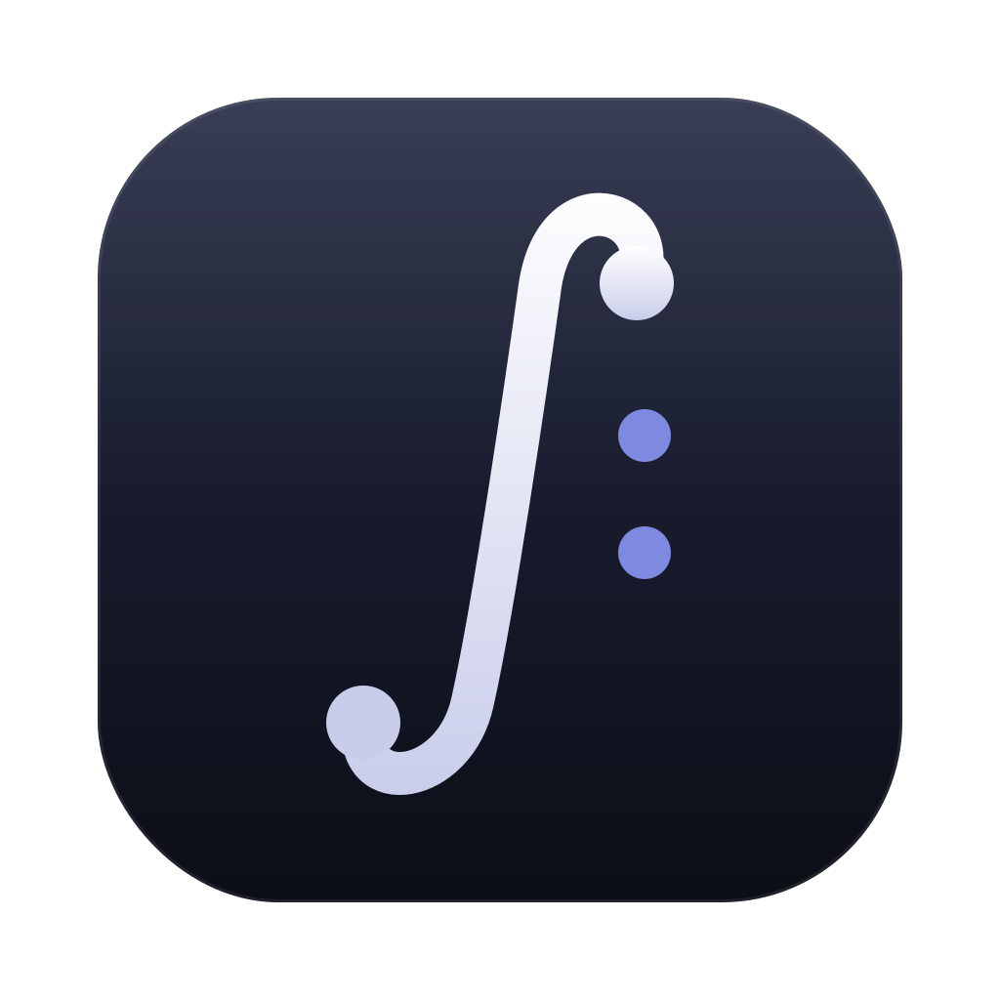

<p align="center"></p>

# Sonora

Minimalist hi-res music player for macOS, Windows, iPhone and Android — FLAC, ALAC, WAV, AIFF, with OneDrive streaming and iCloud Drive libraries.

Reproductor de música minimalista para macOS, Windows, iPhone y Android: FLAC, ALAC, WAV y AIFF en alta resolución, con streaming desde OneDrive e iCloud Drive.

## Características

| | macOS | iPhone | Android |
|---|---|---|---|
| FLAC, ALAC, WAV, AIFF, MP3, AAC | ✓ | ✓ | ✓ |
| Etiquetas y carátulas | ✓ | ✓ | ✓ |
| Biblioteca por álbumes → canciones | ✓ | ✓ | ✓ |
| Frecuencia nativa del DAC | ✓ | ✓ (DAC USB-C) | según el equipo |
| Agregar música | arrastrar carpeta, OneDrive | OneDrive, iCloud Drive, copiar | OneDrive, música del teléfono |
| Streaming desde OneDrive con caché | ✓ | ✓ | ✓ |
| Descargar álbumes para escuchar sin internet | ✓ | ✓ | ✓ |
| Controles en pantalla bloqueada | ✓ | ✓ | ✓ |

## macOS

Requiere macOS 13+ y Xcode o las Command Line Tools.

```bash
cd macOS
cp Secrets.swift.example Sources/Sonora/Secrets.swift   # pon tu Id. de cliente de OneDrive
./make-app.sh
```

Crea `macOS/build/Sonora.app`. Arrastra una carpeta de música sobre la ventana y toca ♪ para ver la biblioteca.

## iPhone

Requiere Xcode 16+ e iOS 17+.

1. Copia `iOS/Secrets.swift.example` a `iOS/Sonora/Secrets.swift`.
2. Para usar OneDrive, registra tu propia app en [Microsoft Entra](https://entra.microsoft.com) → Registros de aplicaciones:
   - Tipos de cuenta: *Cualquier inquilino de Entra ID + cuentas personales de Microsoft*
   - URI de redirección: *Cliente público/nativo* → `sonora://auth`
   - Permisos de API (Microsoft Graph, delegados): `Files.Read`, `offline_access`, `User.Read`
   - Copia el *Id. de aplicación (cliente)* en `Secrets.swift`.
3. Abre `iOS/Sonora.xcodeproj`, elige tu Team en *Signing & Capabilities*, cambia el Bundle Identifier si hace falta y presiona ▶︎.

Más detalles en [iOS/LEEME.md](iOS/LEEME.md).

## Windows

Requiere Windows 10/11 (x64). Instalador: `windows/` → `npm install && npm run dist`. Detalles en [windows/LEEME.md](windows/LEEME.md).

## Android

Requiere Android 8 o superior. Descarga el APK desde [Releases](../../releases) o compílalo:

1. Copia `android/local.properties.example` a `android/local.properties` (ruta del SDK e Id. de cliente de OneDrive).
2. `cd android && ./gradlew assembleRelease`

Más detalles en [android/LEEME.md](android/LEEME.md).

## Proyecto sin fines comerciales

Sonora es un proyecto personal, **sin fines comerciales**: no se vende ni se distribuye con fines de lucro.

## Tipografía

El nombre "Sonora" usa la fuente **Adelicia**, propiedad de **Wahyu Studio** (© 2021 Wahyu Studio).
Se usa en este proyecto **sin fines comerciales**. Los derechos de la fuente pertenecen a su autor;
la licencia MIT de este repositorio **no** se aplica a ella. Si quieres usar Adelicia en otro proyecto,
o con fines comerciales, obtén la licencia correspondiente directamente de Wahyu Studio.

Archivos de la fuente incluidos: `macOS/Resources/Adelicia.ttf`, `iOS/Sonora/Adelicia.ttf`,
`android/app/src/main/res/font/adelicia.ttf` y `windows/src/fonts/Adelicia.ttf`.

## Licencia

Código: MIT (excepto la fuente Adelicia, ver arriba).
